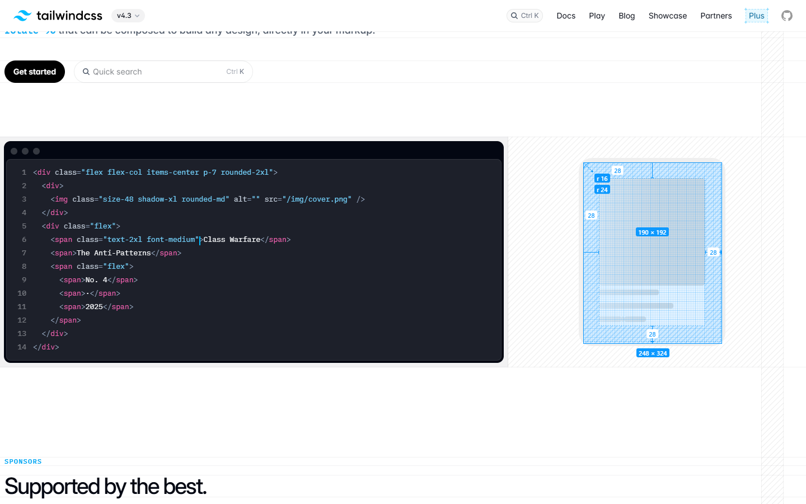
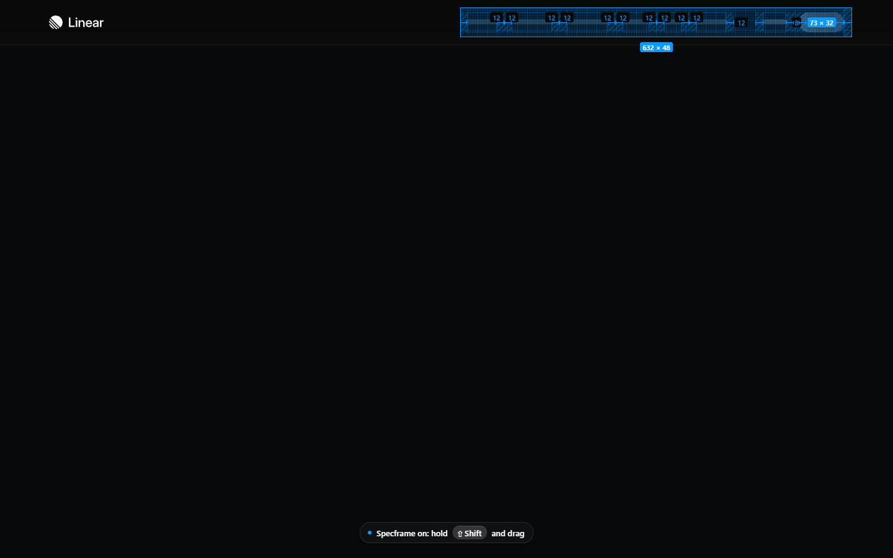
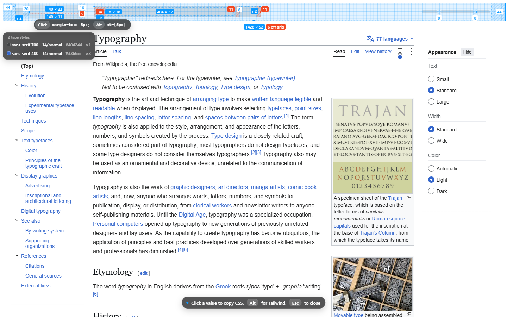
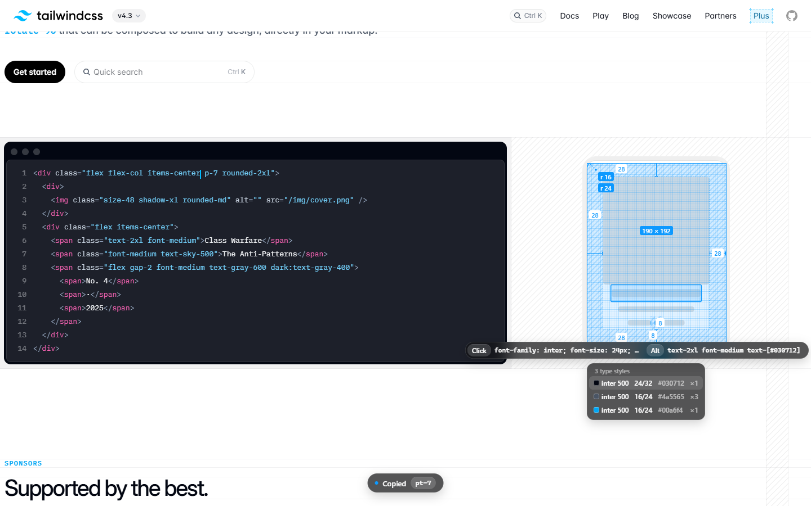
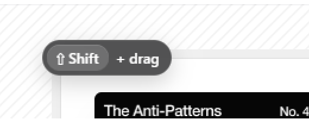

# Specframe

**X-ray any website's layout.** Hold **Shift** and drag a frame over any UI. Inside the frame the
page turns into a skeleton on a 4px grid with its **paddings, gaps, sizes and corner radii**,
measured live from the DOM. Spacing that is **off the grid shows in red**, a panel lists the
**type styles** in the frame, and any value can be **copied as CSS or Tailwind** with one click.

A Chrome / Edge extension (Manifest V3). No build step, no dependencies, no network requests.

## Features

### 1. Measure anything with a Shift-drag

Drag over any part of a page and everything inside the frame is measured: padding on each side
(blue hatching), gaps between neighbouring elements, the content box (dashed), the size of every
block, and corner radii. Numbers draw themselves in and stay live while you move the frame.


<p align="center"><em>Paddings, block size and corner radii of a card on tailwindcss.com. The grid
is anchored to the measured element, so frame corners snap to its 4px grid.</em></p>

### 2. Light and dark pages

The skeleton takes its colours from the page behind it: a shade darker on light pages, a shade
lighter on dark ones. Colours in any CSS format work (including `oklch()` from Tailwind v4).


<p align="center"><em>The navigation on linear.app (dark): 12px paddings on every link, an 8px gap,
the 73 × 32 button and the 632 × 48 frame. The toast at the bottom confirms Specframe is on.</em></p>

### 3. Off-grid spacing in red

Any padding, gap or margin that isn't a multiple of 4, and any odd corner radius, turns red: the
number, the hatched strip and the dimension line. A red **`N off grid`** count sits next to the
frame size, including values whose label had no room. Only spacing someone declared is checked
(padding, `gap`, margins), so leftover space such as the gap between inline words is never
flagged.


<p align="center"><em>Wikipedia's header: 5px, 11px and 34px values show in red, and the frame
reports "6 off grid".</em></p>

### 4. Click a value to copy it as CSS or Tailwind

When you let go, the frame stays **pinned**. Hover any number to see what it copies, **click** to
copy CSS, **Alt-click** to copy Tailwind classes. A toast confirms what landed on the clipboard.


<p align="center"><em>Hovering a 12px padding on linear.app: click copies
<code>padding-right: 12px;</code>, Alt-click copies <code>pr-3</code>.</em></p>

| Value | Click (CSS) | Alt-click (Tailwind v4) |
|---|---|---|
| Padding | `padding-top: 28px;` | `pt-7` |
| Gap | `gap: 16px;` (or `column-gap` / `row-gap`) | `gap-4` (or `gap-x-4` / `gap-y-4`) |
| Margin between siblings | `margin-top: 5px;` | `mt-[5px]` |
| Size | `width: 48px; height: 48px;` | `size-12` |
| Radius | `border-radius: 16px;` (one corner if they differ) | `rounded-2xl` |
| Type style | `font-family: …; font-size: 24px; font-weight: 500; line-height: 32px; color: #030712;` | `text-2xl font-medium text-[#030712]` |

Tailwind names follow v4 (`rounded-sm` = 4px, `rounded-xs` = 2px) and a 16px root font size.
Values off the scale come out as arbitrary values such as `p-[13px]`.

### 5. Type and colour panel

A panel next to the frame lists every text style inside it: colour swatch, font, weight,
size / line height, hex colour and how many elements use it. Line heights off the 4px grid are
red. Hover a row to outline the text that uses that style; click it to copy the whole style.


<p align="center"><em>Three type styles in a card on tailwindcss.com. The hovered row (24/32,
weight 500) outlines the heading it belongs to.</em></p>

### 6. A hint that stays out of the way

While Specframe is on, a small hint follows the cursor and the cursor becomes a crosshair while
Shift is held. A plain Shift-click still works as usual: the drag only starts after the mouse
moves 4px, and Shift is ignored while you type in a field.


<p align="center"><em>The "⇧ Shift + drag" hint next to the cursor.</em></p>

## Install (Edge or Chrome 117+)

1. Download or clone this repository.
2. Open `edge://extensions` (or `chrome://extensions`) and turn on **Developer mode**.
3. Click **Load unpacked** and pick the `extension` folder.
4. Pin Specframe to the toolbar if you like.

## Use

- Click the toolbar button (or press **Alt+Shift+G**) to turn it on for the current tab. The badge shows **ON**.
- Hold **Shift** and drag over any part of the page. Let go and the frame stays pinned.
- Click a number to copy CSS, Alt-click for Tailwind. Rows in the type panel copy the same way.
- **Esc** or a click anywhere else closes the frame (**Esc** during a drag cancels it). A pinned
  frame follows the page when it scrolls.
- Click the toolbar button again to turn Specframe off.
- Local `file://` pages need "Allow access to file URLs" in the extension's details; the button opens that page for you.
- Browser pages (`edge://`, `chrome://`, the Web Store, the PDF viewer) don't allow extensions; the badge shows `–`.

**Permissions:** `activeTab` and `scripting` only. Nothing runs on a page until you click the
button, and Specframe makes no network requests.

## What the frame shows

| Mark | Meaning |
|---|---|
| Blue hatched strip + number | Padding (soft pill) or gap between neighbouring elements |
| Dashed outline | Content box inside the padding |
| Solid blue pill `W × H` | Size of a block (button, chip, image, input) or of the measured element |
| Arc + `r N` | Corner radius (concentric corners are preferred) |
| Shimmering blocks / bars | Skeleton: blocks and lines of text |
| Grid | 4px lines, stronger every 16px, anchored to the measured element |
| **Red** strip, pill or arc | Off the grid: padding, gap or margin not a multiple of 4, or an odd radius |
| Red `N off grid` | How many off-grid values are in the frame |
| Type panel | Each text style in the frame, with how many elements use it |

All numbers are CSS pixels, corrected for page zoom and CSS transforms.

## Files

```
extension/
  manifest.json   MV3 manifest (activeTab + scripting)
  background.js   toolbar button, shortcut, badge, injection
  engine.js       measuring, off-grid check, type panel, SVG overlay, Shift-drag, pin and copy
  page.js         on/off switch, cursor hint (and copy preview), status toast
  overlay.css     overlay styles (inserted with chrome.scripting.insertCSS, so page CSP can't block it)
  icons/          generated by tools/make-icons.js
tools/
  make-icons.js   redraws the icons: node tools/make-icons.js
  try-on-site.js  tries Specframe on a real site in headless Edge/Chrome and saves screenshots
screenshots/      the images in this README, made with tools/try-on-site.js
```

## Try it on a site without installing

Needs Node 22+ and Edge or Chrome.

```bash
node tools/try-on-site.js https://tailwindcss.com "[class*=rounded-3xl][class*=p-2]" out
node tools/try-on-site.js https://linear.app "rect=740,12,1372,60" out
node tools/try-on-site.js https://example.com "text=Some visible words" out
```

The second argument is a CSS selector, `text=…` (frames the card around that text), or
`rect=x1,y1,x2,y2` (viewport coordinates at the top of the page). The script starts a headless
browser with a throwaway profile, injects the extension's files and does a real Shift + drag.
Then it hovers a value, clicks and Alt-clicks it and a type row, scrolls to check that the pinned
frame follows, and presses Esc. It saves a screenshot of each step and prints what landed on the
clipboard.

## Credits

Inspired by [Gridray](https://gridray.dev/). Specframe is an independent implementation and is not
affiliated with it.
